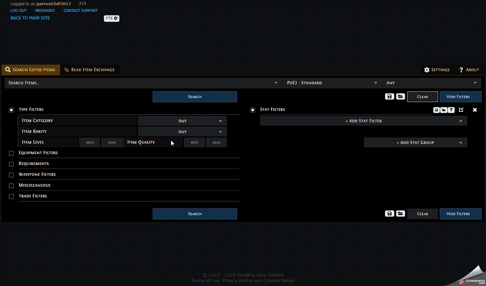

# Poe Trade Official Site Enhancer (maintained fork) - [install link](https://raw.githubusercontent.com/arturino009/poe-trade-official-site-enhancer/master/poe-trade-official-site-enhancer.user.js)

A userscript that adds quality-of-life features to the official Path of Exile and Path of Exile 2 trade sites: real currency value and sorting, a search save manager, an affix selector, grouping by seller and more.

> **This is a fork.** The script was created by **[ghostscript3r](https://github.com/ghostscript3r)**; the original project lives at **[ghostscript3r/poe-trade-official-site-enhancer](https://github.com/ghostscript3r/poe-trade-official-site-enhancer)**. All the core features are their work. This fork keeps it working with current site and API changes and pulls in upstream updates.
> If you find the script useful, please consider supporting the original author: [Patreon](https://www.patreon.com/ghostscripter) - [Paypal](https://www.paypal.com/cgi-bin/webscr?cmd=_s-xclick&hosted_button_id=L5JZS33ADMBQW).

## What this fork changes

* Currency values now come from poe.ninja's current exchange API (the old poe.ninja endpoints were removed, which broke all price conversion).
* PoE2 currency values also come from poe.ninja (the previous source, orbwatch.trade, is offline).
* Bulk exchange listings in the newer `offers` format get their chaos-equivalent value again, and full-page sorting works with the current site.
* The "Chaos Equiv" badge is hidden on items whose asking price is already in chaos (exalted on PoE2).
* Network errors while loading prices no longer leave the page waiting forever.
* Installs and updates come from this repository.

## Features

### Item Search enhancements

* Sort item and currency searches by current chaos/exalted equivalent using **poe.ninja** values.
* Adds a save manager to easily save and reload any item search or even any filter group.
* Adds an affix selector based on [PoEDB](https://poedb.tw/)/[PoE2DB](https://poe2db.tw/) data to easily select all actually possible affixes for the item type you are searching.
* Duplicates search button on top of search controls.
* Results can be grouped by seller.
* For tiered items (essences, sextants...) show the cost of reaching max tier, also enabling sorting by this value.
* For gems show the cost of reaching max quality by buying the gem and the necessary gemcutter's prisms, also enabling sorting by this value.
* Wiki links for additional items and types.

## How to install

### Step 1: Install a script manager

Tested with **Tampermonkey** on Chrome and Firefox. Greasemonkey 4+ is not supported.

* Firefox: [Tampermonkey](https://www.tampermonkey.net/index.php?browser=firefox)
* Chrome: [Tampermonkey](https://www.tampermonkey.net/index.php?browser=chrome)
* Edge: [Tampermonkey](https://www.tampermonkey.net/index.php?browser=edge)
* Opera: [Tampermonkey](https://www.tampermonkey.net/index.php?browser=opera) - [Violentmonkey](https://addons.opera.com/extensions/details/violent-monkey/)

### Step 2: Install the userscript

* **[Install from this fork](https://raw.githubusercontent.com/arturino009/poe-trade-official-site-enhancer/master/poe-trade-official-site-enhancer.user.js)**

Your script manager will offer to install it. Updates are checked automatically against this repository (the script sets `@updateURL`/`@downloadURL` to the link above).

**Already have the original installed?** Installing from the link above replaces it (same script name and namespace), so you won't end up with two copies running. Your saved searches and settings are kept, since they live in the trade site's local storage.

## Issues

Report problems with this fork on the [issue page of this repository](https://github.com/arturino009/poe-trade-official-site-enhancer/issues), not to the original author.

## Credits

* **Original author:** [ghostscript3r](https://github.com/ghostscript3r) — [original repository](https://github.com/ghostscript3r/poe-trade-official-site-enhancer), [releases/changelog](https://github.com/ghostscript3r/poe-trade-official-site-enhancer/releases), [GreasyFork](https://greasyfork.org/scripts/389702-poe-trade-official-site-enhancer), [Patreon](https://www.patreon.com/ghostscripter).
* Affix data (`json/`) is generated by the original project from [PoEDB](https://poedb.tw/)/[PoE2DB](https://poe2db.tw/); the script loads it from the original repository so it stays current.
* Currency values: [poe.ninja](https://poe.ninja/).

License: MIT (see the script header).

## Showcase

* Sort item and currency searches by current chaos/exalted equivalent.

* Save manager for searches and filter groups.

* Affix selector.

* Group results by seller.

* Cost of reaching max tier for tiered items.

* Cost of reaching max quality for gems.

